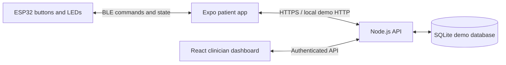

# Fleure LED / BLE demo

**Firmware update:** the ESP32 sketch now controls a pump on GPIO 25 and a
solenoid valve on GPIO 26, replacing the LED outputs. See
[firmware/README.md](firmware/README.md) for the current pin logic and bench-test
limits. The app and simulator below still use their original LED-demo labels.

An ESP32 LED-control prototype with an Expo patient app, Node.js API, and React clinician dashboard. **No pump or cuff control is implemented.**

## Requirements

- Node.js 24.x and npm (the API uses Node's built-in SQLite).
- For hardware: BLE-capable ESP32, Arduino IDE with Espressif Arduino ESP32 **3.x**, USB cable, and a physical Android/iOS phone.
- For native app builds: Android SDK, or macOS + Xcode and iOS signing. Expo Go cannot load the BLE module.

## Run the browser demo

From the repository root:

```sh
npm ci
cp apps/api/.env.example apps/api/.env
```

Edit `apps/api/.env` and set `DEMO_PASSWORD` to your own password (at least 12 characters). On first startup, three local demo accounts are created using that password:

| Email | Role | Access |
|---|---|---|
| patient@fleure.local | Patient | Own sessions |
| clinician@fleure.local | Clinician | Demo Patient's sessions |
| other@fleure.local | Patient | Own sessions; unassigned to clinician |

These are seeded demo accounts, not registration or production identity management. Changing `DEMO_PASSWORD` after the database exists does not reset existing passwords.

Run these in separate terminals:

```sh
npm run dev:api
npm run dev:clinician
npm run web -w @fleure/mobile
```

1. Open the Expo web URL (normally `http://localhost:8081`). Sign in as the patient, with API URL `http://localhost:3001`.
2. Keep **simulator** selected, Connect, press Start and Stop, then Disconnect.
3. Press **Sync uploads / refresh history**. Uploading is explicit in this prototype.
4. Open `http://localhost:5173`, sign in as the clinician, choose Demo Patient, and inspect the session.
5. Changes require **Refresh uploaded data** on the clinician dashboard. No real-time stream is implied.

For the browser patient demo, append its exact origin to `CORS_ORIGINS` in the API `.env`, for example:

```dotenv
CORS_ORIGINS=http://localhost:5173,http://localhost:8081
```

Restart the API after changing configuration. Use the same host spelling (`localhost` versus `127.0.0.1`) as your allowed origins. The clinician dev server proxies `/api` to the local API.

## Connect the ESP32

1. Open `firmware/FleureBLE/FleureBLE.ino` in Arduino IDE. Select your actual ESP32 board and USB port. Install/use Espressif's Arduino ESP32 3.x core; use its bundled BLE library, not a separate legacy ESP32 BLE package.
2. Keep the existing pin arrangement:

| Connection | GPIO / wiring |
|---|---|
| Green Start button | GPIO 18 to GND, `INPUT_PULLUP` |
| Red Stop button | GPIO 19 to GND, `INPUT_PULLUP` |
| Green LED | GPIO 25 through an appropriate resistor to LED, then GND |
| Red LED | GPIO 26 through an appropriate resistor to LED, then GND |

GPIO availability depends on the exact board. These pins match the supplied sketch; change them if your board requires it. The original ESP32 and ESP32-S3 support BLE; an ESP32-S2 does not.

3. Flash over USB. Serial Monitor at **115200 baud** should report `Fleure LED prototype ready, OFF`.
4. Build/install the patient development app:

```sh
npm run android -w @fleure/mobile
# or, with Xcode/signing configured:
npm run ios -w @fleure/mobile -- --device
```

After the first native install, use `npm run dev:mobile` for JS development. Rebuild after native dependency/config changes. This repo pins Expo SDK 58; native compilation and actual BLE operation still need verification on your phone/board.

5. For a physical phone, set API `HOST=0.0.0.0` in `.env` and restart the API. Enter `http://YOUR_COMPUTER_LAN_IP:3001` in the patient app. Both devices must share a reachable network; allow the API port through your firewall. Native apps do not use browser CORS. If your OS blocks local cleartext HTTP, use an HTTPS development endpoint. Production traffic must use HTTPS.
6. Sign in, switch to **real ESP32 BLE**, then Connect. The app connects to the first device advertising the Fleure service, so power only one prototype for this demo.
7. Test the cases in [docs/TESTING.md](docs/TESTING.md). The app must stay in the foreground. Backgrounding disconnects and ends the session; restarting records interrupted sessions as unknown.

## Behavior and boundaries

- ESP32 owns the ON/OFF state; the app displays reports rather than guessing from button taps.
- Physical red Stop takes priority. Physical green Start is debounced and requires release/re-press after Stop.
- An established BLE link loss stops the LEDs. Remote ON also expires after approximately five seconds without heartbeats (phone sends every second).
- Physical Start also works without a phone. Heartbeat timeout applies to remotely started ON, not independent local operation.
- Disconnect is displayed as **unknown**, since the phone cannot prove the board's resulting state after losing communication.
- App sessions and events persist in local AsyncStorage until uploaded. Tokens are kept in memory; app restart requires login. Retry uses stable UUIDs to avoid duplicate events. Do not clear app storage before syncing.
- The API persists accounts, tokens, sessions, and events in `apps/api/fleure.db`. The server enforces patient ownership and clinician assignments. Records are phone-reported, not cryptographically attested by the device.
- BLE pairing/access control, device selection/provisioning, independent emergency-stop hardware, pressure control, and medical use are outside this LED demo. Any nearby compatible BLE client can issue prototype commands.
- This implementation uses SQLite for a self-contained local demo, replacing the initially proposed PostgreSQL/Prisma setup. Migrate storage and identity management before deployment. No cloud service is provisioned.

## Layout

```text
apps/mobile       Expo / React Native patient app + simulator
apps/clinician    React / Vite clinician web dashboard
apps/api          Express / TypeScript API + persistent SQLite
firmware          ESP32 Arduino sketch
packages/protocol BLE protocol documentation
```



## Checks

```sh
npm run check
npm test
npm run build
npm exec -w @fleure/mobile -- expo install --check
npm exec -w @fleure/mobile -- expo export --platform web
```

See [docs/TESTING.md](docs/TESTING.md) for hardware acceptance tests and verification limitations.
